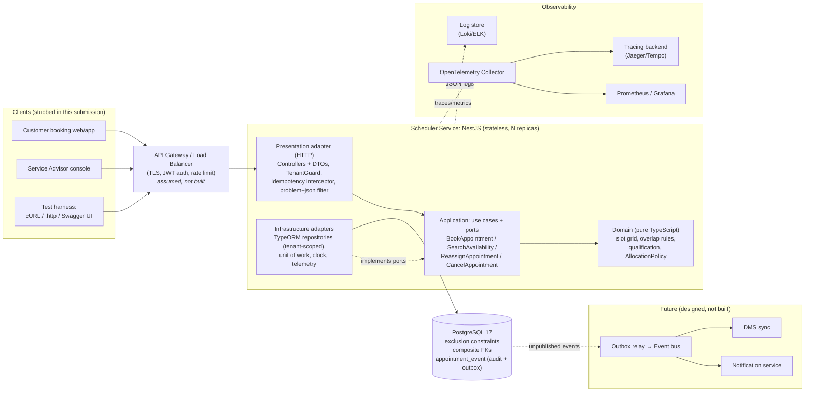
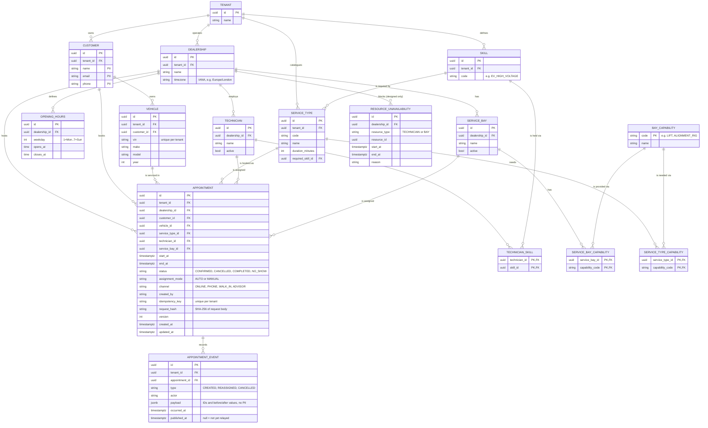
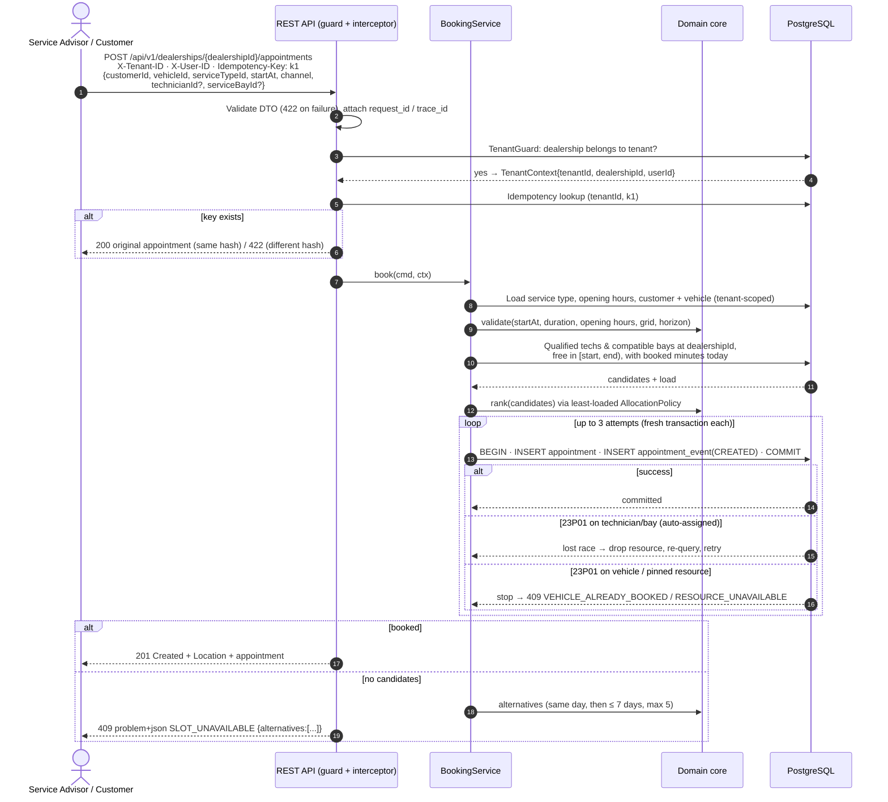

# System Design: Unified Service Scheduler (Scenario A)

> **Version:** 1.0 · **Domain:** Ownership
> **Implementation layer:** Backend (NestJS REST API + PostgreSQL). The frontend is stubbed with the generated OpenAPI contract, Swagger UI and cURL/`.http` examples.

---

## 1. Problem Statement

Dealerships book service appointments by hand (phone, spreadsheets, paper diaries). This leads to double-booked bays, technicians assigned to jobs they aren't qualified for, and no single view of workshop capacity. The Unified Service Scheduler replaces that process with a system that:

1. Takes a request for a service appointment for a **specific vehicle**, **service type** and **dealership** at a **desired time**.
2. Checks in real time, before confirming, that **both** a **ServiceBay** and a **qualified Technician** are free for the **whole service duration**.
3. On success, stores a persistent **Appointment** that links the customer, vehicle, technician and service bay.

The hard part is **correctness under concurrency**. Two advisors booking the last free slot at the same moment must never both succeed. The design guarantees this in the database, not only in application code.

---

## 2. Assumptions

The brief leaves these points open. Each one is a deliberate choice, and each can be revisited.

### 2.1 Booking semantics

| # | Assumption | Rationale |
|---|---|---|
| A1 | **Auto-assign by default, manual override allowed.** The requester picks dealership, vehicle, service type and start time, and the system assigns the technician and bay. Two override paths: **(a)** at booking time, the caller may pin `technicianId` and/or `serviceBayId`, and the system auto-assigns whatever isn't pinned. **(b)** After booking, a service advisor can **reassign** the technician and/or bay. Every override goes through the same qualification, compatibility and overlap checks as auto-assignment, so manual changes can't double-book. Each appointment records `assignmentMode = AUTO \| MANUAL`. | The brief makes checking for a free bay and a qualified technician the system's job. Advisors still need control for real-world exceptions (customer preference, technician off sick). |
| A2 | Each appointment uses **exactly one technician and one bay for its entire duration**. No splitting or hand-overs. | Matches the brief ("for the entire service duration"). |
| A3 | Duration comes from the **ServiceType** (e.g. Oil Change = 30 min, Major Service = 180 min). The client never supplies it. | Stops clients from under-booking. Durations belong to the tenant's service catalogue. |
| A4 | Time intervals are **half-open `[start, end)`**. A 09:00–10:00 job and a 10:00–11:00 job don't conflict. | The standard way to avoid edge-touching false conflicts. |
| A5 | **No buffer/clean-up time** between appointments in the MVP. A per-service-type `buffer_minutes` can be added later. | Keeps the MVP simple. The schema change is trivial. |
| A6 | Start times must line up with a **15-minute slot grid**, be **in the future**, and fall within a **90-day booking horizon**. | Keeps availability responses finite and readable for UIs. |
| A7 | The appointment must fit **entirely inside the dealership's opening hours** for that local day. Jobs don't run overnight. | Matches how real workshops run. |
| A8 | **Technicians work the dealership's opening hours.** Individual shifts, breaks and leave are **designed but not built**: the `resource_unavailability` table is in the data model (§4) as the extension point. | The brief doesn't mention rostering. |
| A9 | A **vehicle can't have two overlapping confirmed appointments**, even at different sites of the same tenant. | A car can't be in two bays at once. Enforced the same way as technician and bay conflicts. |
| A10 | If the desired time isn't available, the API returns **409 Conflict with up to 5 alternative start times**. The search covers the same day first, then up to **7 days** ahead. It does **not** book an alternative automatically. | Booking a time the user didn't ask for would be surprising. The search limit keeps a fully booked dealership from triggering a 90-day scan on every 409. |
| A11 | **Allocation policy: least-loaded.** When several resources are free, choose the qualified **technician** with the **fewest booked minutes that day**, and the compatible **bay** with the **fewest booked minutes that day**. "That day" is the dealership's local date, and only `CONFIRMED` appointments count. **Tie-breaks:** fewer capabilities first (so a plain lift bay is used before an EV bay, keeping scarce bays free), then ID (deterministic). Load is counted **per dealership only**. | Spreads workload and wear evenly. Simple, explainable and testable. It sits behind an `AllocationPolicy` interface so another strategy can be swapped in. |
| A12 | Lifecycle: `CONFIRMED → CANCELLED` is built in the MVP. `CONFIRMED → COMPLETED \| NO_SHOW` exist in the status enum but are set by a **future workshop/DMS integration**, with no MVP endpoint. Only `CONFIRMED` appointments hold resources. Rescheduling = cancel + rebook. | Cancelling must free capacity. The workshop workflow (check-in, in-progress, completion) belongs to the DMS. |

### 2.2 Qualification model

A **skill** answers *"can this technician do this job?"*. A **bay capability** answers *"can this bay physically host this job?"*. Together they define what "qualified technician" and "suitable bay" mean in the brief.

| # | Assumption | Example |
|---|---|---|
| Q1 | Each **ServiceType** needs exactly one **skill**. A technician is *qualified* if they hold it. | An EV battery check needs `EV_HIGH_VOLTAGE`. Alice (`GENERAL`, `EV_HIGH_VOLTAGE`) qualifies and Bob (`GENERAL`) doesn't. |
| Q2 | Each **ServiceType** needs zero or more **bay capabilities**. A bay is *compatible* if it has **all** of them. | A wheel alignment needs `LIFT` + `ALIGNMENT_RIG`, so only Bay 2 qualifies. |
| Q3 | Technicians and bays belong to **one dealership** (site). They aren't shared across sites, even within the same tenant. | |

### 2.3 Data and scope

| # | Assumption |
|---|---|
| D1 | **Tenants, dealerships, customers, vehicles, technicians, bays, skills and service types already exist.** In production they would come from other Keyloop systems (CRM, DMS). The MVP seeds them and exposes read-only reference endpoints, with no CRUD for them. |
| D2 | The vehicle in a request must belong to the customer in the request. |
| D3 | All timestamps are stored in **UTC** (`timestamptz`). Each dealership has an **IANA time zone** (e.g. `Europe/London`). The API accepts and returns ISO-8601 with offsets. Opening hours are interpreted in the dealership's local time, so DST is handled correctly. |
| D4 | **Authentication is out of scope, but tenant context is not.** An upstream API gateway is assumed to authenticate callers and forward a verified identity. The MVP takes the tenant from an `X-Tenant-ID` header and the user from an `X-User-ID` header, both standing in for JWT claims. Tenant isolation is enforced on every request (§2.4). |
| D5 | **Notifications** (email/SMS) are out of scope. Domain events are written to an outbox (§4) so a notification service can consume them later. |

### 2.4 Multi-tenancy: knowing where each appointment comes from

**T1: Tenancy model.** There are two levels:

```
Tenant (dealer group / Keyloop customer, e.g. "Acme Motor Group")
 ├── Customers, vehicles, skills, service-type catalogue   ← tenant-scoped (shared across the group's sites)
 └── Dealership (physical site, e.g. "Acme Toyota Leeds")
      ├── Service bays, technicians, opening hours          ← site-scoped
      └── Appointments                                      ← site-scoped
```

A customer of Acme Motor Group can book at any Acme site. Acme's data is never visible to another tenant.

**How an appointment's origin is known.** Every booking carries three pieces of context, each from a different source:

| Context | Source | Why |
|---|---|---|
| **Tenant** (`tenantId`): *whose data is this?* | **Trusted identity**, never the request body. In production it's a JWT claim (`tenant_id`, plus the `dealership_ids` the user may act for). In the MVP it's the `X-Tenant-ID` header. | A client must not be able to choose its own tenant. |
| **Dealership** (`dealershipId`): *which site?* | **The URL path:** `/api/v1/dealerships/{dealershipId}/…` | The customer or advisor picks a site. The path makes the scope explicit, and every route under it shares one guard. |
| **Channel** (`channel`): *how was it booked?* | Request body enum `ONLINE \| PHONE \| WALK_IN \| ADVISOR` (default `ADVISOR`). `createdBy` comes from the identity. | Audit and reporting. Doesn't affect assignment. |

**T2: How auto-assign uses this.** A NestJS `TenantGuard` resolves every request into a `TenantContext { tenantId, dealershipId, userId }`, held in `AsyncLocalStorage`, **before** any business logic runs:

1. If `dealershipId` doesn't exist, or `dealership.tenant_id ≠ tenantId`, return **404**. It's not 403, because 403 would reveal that another tenant's site exists.
2. The customer, vehicle and service type in the request must belong to `tenantId`. Otherwise return **404**.
3. The allocator builds its candidate pool with `WHERE dealership_id = :dealershipId`. A dealership belongs to exactly one tenant, so the pool is site-scoped and therefore tenant-scoped. **The allocator can never see, count or assign another site's or tenant's resources.**
4. A pinned or reassigned `technicianId`/`serviceBayId` from another dealership returns **422 `RESOURCE_NOT_IN_DEALERSHIP`**.

**T3: Defence in depth.** Isolation is enforced in three layers, so one bug can't leak or cross-assign data:

1. **Application:** the guard, plus repositories that require a `TenantContext` and always apply the tenant/site filter. No method exists that queries "all appointments".
2. **Database integrity:** every tenant-scoped table stores `tenant_id`. Site-scoped tables (`technician`, `service_bay`, `opening_hours`) store `dealership_id` and reach the tenant through it. **Composite foreign keys** on `appointment` tie every reference to the same site or tenant (§4), so a cross-site or cross-tenant appointment is **rejected by the database** even if application code is wrong.
3. **Database access *(designed only)*:** PostgreSQL **Row-Level Security** with `tenant_id = current_setting('app.tenant_id')`, set with `SET LOCAL` at the start of each transaction, which is safe with connection pooling.

**T4: Isolation model.** A shared database and schema with a `tenant_id` column (the "pool" model). It's cheapest to run and fits the assumed tenant count. A very large tenant could later move to its own database (the "silo" model) without API changes, because every query is already tenant-scoped.

### 2.5 Scale (to size the design)

| Metric | Assumption |
|---|---|
| Tenants / dealerships | ~200 tenants (dealer groups) running ~1,000 dealerships in total |
| Per dealership | 10–30 bays, 10–50 technicians, 50–300 appointments/day |
| Traffic | Read-heavy: ~20 availability checks per booking. Peak ~50 bookings/s system-wide. |
| Contention | Always **within one dealership**, so the data partitions naturally by `tenant_id` → `dealership_id`. |

### 2.6 MVP scope: built vs designed

| Built in this submission | Designed only (documented, not implemented) |
|---|---|
| Availability search, booking with auto-assign and optional pinning, alternative slots on conflict | JWT authentication (the MVP uses `X-Tenant-ID` / `X-User-ID` headers) |
| Get and list appointments, manual reassign, cancel | Row-Level Security (T3 layer 3) |
| Tenant guard, composite-FK isolation, exclusion-constraint concurrency control | Outbox relay, event bus and notification service |
| Idempotent booking (`Idempotency-Key`) | Technician shifts/leave (`resource_unavailability`) |
| Audit/outbox events written in the same transaction | `COMPLETED` / `NO_SHOW` transitions (DMS integration) |
| Structured logs, metrics, traces, health probes, problem+json errors | Caching, read replicas, sharding, alert rules and dashboards |
| OpenAPI/Swagger, seed data, docker compose, unit/integration/concurrency tests | Data-retention jobs (§10) |

---

## 3. Architecture

### 3.1 High-level diagram



### 3.2 Component responsibilities

| Component | Role |
|---|---|
| **Clients** | Customer booking UI and service-advisor console. **Stubbed** with the generated OpenAPI spec (Swagger UI), a `requests.http` file and cURL scripts. |
| **API Gateway** *(assumed)* | TLS termination, JWT authentication, rate limiting, routing. Not built. |
| **Presentation adapter (HTTP)** | HTTP concerns only. Maps DTOs to use-case commands and domain errors to HTTP. Never imports infrastructure. Request validation (DTOs + global `ValidationPipe`, set to return **422**). `TenantGuard` (§2.4). `Idempotency-Key` interceptor. RFC 9457 `problem+json` exception filter. Request-ID middleware. |
| **Clean Architecture** | Dependencies point inward only: presentation and infrastructure → application → domain. The application layer defines **ports** (persistence, unit of work, clock, IDs, telemetry). Infrastructure implements them, and the Nest modules (composition root) bind them. Per-layer ESLint import rules enforce this in CI. |
| **AvailabilityService** (`SearchAvailability` use case) | Loads one dealership's resources and the day's confirmed appointments in a bounded number of queries, then calls the domain core to compute free slots and alternatives. |
| **BookingService** (`BookAppointment` use case) | Runs the booking transaction: validate → find candidates → allocate → insert appointment + event → commit. Handles constraint conflicts with bounded retries (§5). |
| **AssignmentService** (`ReassignAppointment` / `CancelAppointment` use cases) | Manual reassignment and cancellation, with optimistic version checks and the same qualification and overlap guarantees. |
| **Domain core** | Plain TypeScript with **no I/O and no Nest dependencies**: interval overlap, slot-grid generation within opening hours, qualification/compatibility matching, `AllocationPolicy` (A11). Most unit tests target this layer. |
| **Repositories** (infrastructure adapters) | TypeORM implementations of application ports, bound in the composition root. ORM entities are mapped to domain models, and driver errors are translated by constraint name into typed port outcomes. Every method requires a `TenantContext`. Write paths use explicit SQL where precise control is needed (version-checked updates, §5). |
| **PostgreSQL** | System of record. **Exclusion constraints** guarantee no double-booking. **Composite FKs** guarantee tenant and site integrity. `appointment_event` is both the audit trail and the transactional outbox. |
| **Observability stack** | OpenTelemetry traces and metrics, structured JSON logs (§8). |
| **Outbox relay / Notification / DMS sync** *(future)* | Polls `appointment_event WHERE published_at IS NULL`, publishes to a bus, and marks the events published. |

---

## 4. Data Model



**Key constraints:**

```sql
CREATE EXTENSION IF NOT EXISTS btree_gist;

-- 1. No double-booking (only CONFIRMED appointments hold resources)
ALTER TABLE appointment ADD CONSTRAINT no_technician_overlap
  EXCLUDE USING gist (technician_id WITH =, tstzrange(start_at, end_at, '[)') WITH &&)
  WHERE (status = 'CONFIRMED');
ALTER TABLE appointment ADD CONSTRAINT no_bay_overlap
  EXCLUDE USING gist (service_bay_id WITH =, tstzrange(start_at, end_at, '[)') WITH &&)
  WHERE (status = 'CONFIRMED');
ALTER TABLE appointment ADD CONSTRAINT no_vehicle_overlap
  EXCLUDE USING gist (vehicle_id WITH =, tstzrange(start_at, end_at, '[)') WITH &&)
  WHERE (status = 'CONFIRMED');
ALTER TABLE appointment ADD CONSTRAINT valid_interval CHECK (end_at > start_at);

-- 2. Tenant/site integrity: every reference must belong to the same site or tenant
ALTER TABLE dealership   ADD CONSTRAINT uq_dealership_tenant UNIQUE (id, tenant_id);
ALTER TABLE technician   ADD CONSTRAINT uq_technician_site   UNIQUE (id, dealership_id);
ALTER TABLE service_bay  ADD CONSTRAINT uq_bay_site          UNIQUE (id, dealership_id);
ALTER TABLE customer     ADD CONSTRAINT uq_customer_tenant   UNIQUE (id, tenant_id);
ALTER TABLE vehicle      ADD CONSTRAINT uq_vehicle_tenant    UNIQUE (id, tenant_id);
ALTER TABLE service_type ADD CONSTRAINT uq_service_tenant    UNIQUE (id, tenant_id);

ALTER TABLE appointment
  ADD CONSTRAINT fk_appt_site     FOREIGN KEY (dealership_id, tenant_id)   REFERENCES dealership   (id, tenant_id),
  ADD CONSTRAINT fk_appt_tech     FOREIGN KEY (technician_id, dealership_id)  REFERENCES technician  (id, dealership_id),
  ADD CONSTRAINT fk_appt_bay      FOREIGN KEY (service_bay_id, dealership_id) REFERENCES service_bay (id, dealership_id),
  ADD CONSTRAINT fk_appt_customer FOREIGN KEY (customer_id, tenant_id)     REFERENCES customer     (id, tenant_id),
  ADD CONSTRAINT fk_appt_vehicle  FOREIGN KEY (vehicle_id, tenant_id)      REFERENCES vehicle      (id, tenant_id),
  ADD CONSTRAINT fk_appt_service  FOREIGN KEY (service_type_id, tenant_id) REFERENCES service_type (id, tenant_id);

-- 3. Idempotency and query performance
CREATE UNIQUE INDEX uq_appt_idempotency ON appointment (tenant_id, idempotency_key);
CREATE INDEX ix_appt_site_day   ON appointment (dealership_id, start_at) WHERE status = 'CONFIRMED';
CREATE UNIQUE INDEX uq_vehicle_vin ON vehicle (tenant_id, vin);
CREATE INDEX ix_event_unpublished ON appointment_event (occurred_at) WHERE published_at IS NULL;
```

The partial `WHERE status = 'CONFIRMED'` means cancelled appointments free their resources straight away. The composite foreign keys make cross-site or cross-tenant appointments impossible at the storage layer (T3).

**Migration note:** all migrations are **hand-written SQL** and are the schema's single source of truth. TypeORM's schema diff matches exclusion constraints and foreign keys **by name only**: it drops ones it doesn't know about and ignores changes to an expression. So the project never uses `migration:generate` or `synchronize` (feature 001 research R3, verified from TypeORM 0.3.31 source). A schema integration test asserts that every exclusion constraint and composite FK exists after migrations.

---

## 5. Concurrency and Consistency Strategy

**The race:** two requests both see "Bay 3 + Tech Alice free at 10:00", and both insert. An application-level check alone (*check-then-act*) can't stop this.

**Options considered:**

| Option | Pros | Cons | Verdict |
|---|---|---|---|
| App-level check only | Simple | **Wrong under concurrency** | ❌ |
| `SERIALIZABLE` isolation | Correct | Many serialization failures under load; every caller must retry | ❌ |
| `SELECT … FOR UPDATE` on technician/bay rows | Correct | Blocking. Lock ordering is needed to avoid deadlocks. It locks the whole resource, not just the time range. | ⚠️ alone. **Used only as deadlock avoidance alongside the constraints** (see below). |
| Per-dealership advisory lock | Simple, correct | Serialises **all** bookings at a site, so throughput is capped | ⚠️ fallback |
| **DB exclusion constraints + optimistic retry** | Correct by construction. Non-blocking. Conflicts are only on truly overlapping ranges. The guarantee holds even for bugs or other writers. | PostgreSQL-specific | ✅ **Chosen** |

### 5.1 Booking algorithm (BookingService)

1. **Idempotency.** Look up `(tenant_id, Idempotency-Key)`.
   - Found with the same `request_hash` → return the original appointment (**200**).
   - Found with a different hash → **422 `IDEMPOTENCY_KEY_REUSED`**.
2. **Validate:** the vehicle belongs to the customer, plus slot grid, horizon and opening hours (A6, A7).
3. **Candidates.** Find qualified technicians and compatible bays at the dealership, each with no overlapping `CONFIRMED` appointment and with its booked minutes for the day. Pinned resources are used as-is after the same checks. Rank with `AllocationPolicy`.
4. **Insert.** In one transaction, `INSERT` the appointment with the top-ranked pair, plus an `appointment_event (CREATED)` row. Commit.
5. **Handle conflicts.** Use the violated constraint's **name** (`QueryFailedError.driverError.constraint` from the `pg` driver), not just the SQLSTATE:

   | Error | Meaning | Action |
   |---|---|---|
   | `23P01` on `no_technician_overlap` / `no_bay_overlap`, resource **auto-assigned** | Lost the race for that resource | Drop it, re-query candidates in a **fresh transaction**, retry. **At most 3 attempts in total.** |
   | `23P01` on technician/bay, resource **pinned** | The resource the user chose is taken | **409 `RESOURCE_UNAVAILABLE`**, no retry |
   | `23P01` on `no_vehicle_overlap` | The vehicle already has a booking at that time | **409 `VEHICLE_ALREADY_BOOKED`**, no retry (it can never succeed) |
   | `23505` on `uq_appt_idempotency` | A concurrent duplicate with the same key won | Re-read and return the original (**200**). Apply the hash check from step 1. |
   | `40P01` / `40001` (no constraint) | PostgreSQL aborted the transaction to break a deadlock or serialization failure | Typed `transient` outcome: re-check idempotency, then retry the **same** candidates in a fresh transaction, within the same 3-attempt budget. |

   **Any conflict first re-checks the Idempotency-Key.** A duplicate of a request that already won can surface as a technician, bay or vehicle conflict, not only as `23505`.

   **Deadlock avoidance (added during implementation).** Concurrent inserts that conflict on several exclusion constraints can wait on each other in cycles. The 20-way identical-burst test produced `40P01` storms that retries alone couldn't fix. So before the `INSERT` (or a reassignment `UPDATE`), the adapter takes `SELECT … FOR NO KEY UPDATE` row locks on technician → bay → vehicle, **always in that order**. Contenders queue instead of forming cycles, and the next one sees the committed winner and fails fast with `23P01`. **The exclusion constraints remain the guarantee.** The locks only remove deadlocks: 80 stress scenarios (1,600 concurrent requests) gave 0 deadlocks. This is justified in the feature plan's Complexity Tracking (Constitution I).

6. **No candidates left** (or attempts used up) → **409 `SLOT_UNAVAILABLE`** with up to 5 alternatives (A10).

A booking is a single `INSERT` (plus its event), so each retry is a fresh transaction and no savepoints are needed.

### 5.2 Manual reassignment and cancellation (AssignmentService)

Reassignment runs in one transaction:
1. Load the appointment (tenant-scoped).
2. Validate the new technician (same site, qualified) and/or bay (same site, compatible).
3. Run the update:
   ```sql
   UPDATE appointment
      SET technician_id = :t, service_bay_id = :b, assignment_mode = 'MANUAL',
          version = version + 1, updated_at = now()
    WHERE id = :id AND tenant_id = :tenant AND version = :expectedVersion AND status = 'CONFIRMED';
   ```
4. **Zero affected rows → 409 `STALE_VERSION`** (or 409 `NOT_CONFIRMED` after re-reading). TypeORM's `@VersionColumn` only increments the version and **does not check it on update**, so the check has to be this explicit `WHERE` plus the affected-row count.
5. `23P01` → **409 `RESOURCE_UNAVAILABLE`**. The resource was chosen explicitly, so there's no retry.
6. Insert `appointment_event (REASSIGNED)` with before and after IDs.

Cancellation uses the same version-checked `UPDATE … SET status = 'CANCELLED'` and writes a `CANCELLED` event. The partial exclusion constraints free the slot immediately.

**Availability is advisory, booking is authoritative.** `GET /availability` is a snapshot that can be stale a few milliseconds later. Only the write paths guarantee the slot.

---

## 6. Data Flow

### 6.1 Booking (happy path, race and replay)



### 6.2 Availability check

1. `GET /api/v1/dealerships/{id}/availability?serviceTypeId=…&date=2026-11-10` (`date` is the dealership-local date).
2. Load opening hours, qualified technicians, compatible bays, and every `CONFIRMED` appointment at that dealership on that local date. That's **4 queries**, independent of the number of slots.
3. In the domain core, for each 15-minute grid start where `start + duration ≤ close`, the slot is available if **at least one** qualified technician **and** **at least one** compatible bay are free over `[start, end)`.
4. Return `[{startAt, endAt, availableTechnicians, availableBays}]`.

Cost per request is about `slots (~40) × resources (~80) × appointments-per-resource (~5)`. That runs in memory in milliseconds.

### 6.3 Manual reassignment

The advisor console loads `GET …/technicians` and `GET …/service-bays` for the site. The advisor then sends `PATCH …/appointments/{id}/assignment {technicianId?, serviceBayId?, version}`. AssignmentService validates and applies the version-checked update (§5.2), and returns **200** with the new `version` or a **409/422** problem.

---

## 7. API Surface (summary)

The full contract is generated by `@nestjs/swagger` as OpenAPI 3.1 at `/openapi.json`, with Swagger UI at `/docs`. Every request needs tenant context (`X-Tenant-ID` / `X-User-ID` in the MVP, JWT claims in production). Every business route sits under `/dealerships/{id}`, so it is site-scoped by construction.

| Method | Path | Purpose | Responses |
|---|---|---|---|
| `GET` | `/api/v1/dealerships` | Dealerships of the caller's tenant | 200 |
| `GET` | `/api/v1/service-types` | The tenant's service catalogue | 200 |
| `GET` | `/api/v1/dealerships/{id}/technicians`, `/service-bays` | Site resources with skills/capabilities (for the override UI) | 200, 404 |
| `GET` | `/api/v1/dealerships/{id}/availability` | Free start times for a service type on a date | 200, 404, 422 |
| `POST` | `/api/v1/dealerships/{id}/appointments` | Book: auto-assign, or pinned `technicianId`/`serviceBayId`. Requires `Idempotency-Key`. | 201, 200 (replay), 404, 409, 422 |
| `GET` | `/api/v1/dealerships/{id}/appointments/{apptId}` | Fetch an appointment | 200, 404 |
| `GET` | `/api/v1/dealerships/{id}/appointments?date=&status=&technicianId=&cursor=` | Advisor day view, cursor-paginated | 200 |
| `PATCH` | `/api/v1/dealerships/{id}/appointments/{apptId}/assignment` | Manual reassign `{technicianId?, serviceBayId?, version}` | 200, 404, 409, 422 |
| `POST` | `/api/v1/dealerships/{id}/appointments/{apptId}/cancel` | Cancel `{version}` and free resources | 200, 404, 409 |
| `GET` | `/api/v1/dealerships/{id}/appointments/{apptId}/events` | Audit trail | 200, 404 |
| `GET` | `/health/live`, `/health/ready` | Liveness / readiness (DB ping) | 200, 503 |
| `GET` | `/metrics` | Prometheus scrape endpoint | 200 |

**Errors** use RFC 9457 `application/problem+json` with a machine-readable `code`:

| HTTP | Codes |
|---|---|
| 404 | `NOT_FOUND` (also used for other tenants' resources, so their existence isn't revealed) |
| 409 | `SLOT_UNAVAILABLE` (with `alternatives`), `RESOURCE_UNAVAILABLE`, `VEHICLE_ALREADY_BOOKED`, `STALE_VERSION`, `NOT_CONFIRMED` |
| 422 | `VALIDATION_FAILED`, `START_IN_PAST`, `OUTSIDE_OPENING_HOURS`, `NOT_ON_SLOT_GRID`, `OUTSIDE_BOOKING_HORIZON`, `VEHICLE_NOT_OWNED_BY_CUSTOMER`, `TECHNICIAN_NOT_QUALIFIED`, `BAY_NOT_COMPATIBLE`, `RESOURCE_INACTIVE`, `RESOURCE_NOT_IN_DEALERSHIP`, `IDEMPOTENCY_KEY_REUSED` |
| 500 | `INTERNAL_ERROR` (generic detail only; the cause is logged, never returned) |

---

## 8. Observability Strategy

| Pillar | What | How |
|---|---|---|
| **Logging** | Structured JSON, one line per event. Each line carries `request_id`, `trace_id`, `tenant_id`, `dealership_id`, `appointment_id`, `assignment_mode`, `channel`, `outcome`, `attempt`, `constraint`. **No PII**: customer name, email and phone are never logged; IDs only. | `nestjs-pino`. Middleware generates or propagates `X-Request-ID`, held in `AsyncLocalStorage`. |
| **Metrics** | **RED:** rate, errors and latency per route. **Business:** `bookings_total{outcome, assignment_mode, channel}`, `booking_conflicts_total{constraint}`, `booking_retry_attempts_total`, `reassignments_total`, `cancellations_total`, `availability_slots_returned` (histogram), `booking_duration_seconds` (histogram). **Saturation:** DB pool in-use and wait time, event-loop lag. | OpenTelemetry metrics → Prometheus exporter at `/metrics` |
| **Tracing** | One trace per request, with child spans for each DB query and for `allocate`, `computeAvailability` and `findAlternatives`, so slow queries and retry storms are visible. | `@opentelemetry/sdk-node` with auto-instrumentation (http, express, pg), OTLP → Jaeger locally |
| **Tenant attribution** | `tenant_id` / `dealership_id` go on **logs and span attributes** (high cardinality is fine there) but **never on metric labels**, which would mean thousands of series per metric. Per-tenant usage comes from logs or SQL. | Convention enforced in a shared metrics helper |
| **Audit** | `appointment_event` records who created, reassigned or cancelled each appointment and when. Exposed via `GET …/events`. | Written in the same transaction as the change |
| **Health** | `/health/live` (process up), `/health/ready` (DB reachable, migrations applied). | `@nestjs/terminus` |

### 8.1 SLOs and alerting

| SLO (30-day window) | Target | Alert (error-budget burn rate) |
|---|---|---|
| Booking API **availability**: requests that don't return 5xx | 99.9% | Fast burn: >14× over 1 h. Slow burn: >6× over 6 h. |
| **Availability-search latency** | 95% < 300 ms | p95 > 300 ms for 15 min |
| **Booking latency** | 95% < 500 ms | p95 > 500 ms for 15 min |
| **Double bookings** | 0 (guaranteed by constraints) | Not alerted. Instead, alert on an unusual rise in `booking_conflicts_total` (UI double-submits or a hot site). |
| **Readiness** | – | `/health/ready` failing on any replica for 2 min |

In local `docker compose`, traces go to Jaeger, so a reviewer can follow one booking end to end.

---

## 9. Technology Choices

| Concern | Choice | Justification |
|---|---|---|
| Language / runtime | **TypeScript 5 (strict)** on **Node.js 24 LTS** | One language across backend and any future frontend. Strict typing catches AI-generated mistakes at compile time. Non-blocking I/O suits this I/O-bound API. Node 24 is the current active LTS. |
| Web framework | **NestJS 11** + `class-validator` / `class-transformer` + **`@nestjs/swagger`** | Modules, DI, guards, interceptors and filters give a maintainable layered structure out of the box. DI makes services easy to test. The OpenAPI spec is generated from the DTOs and doubles as the frontend stub/contract. |
| Database | **PostgreSQL 17** | `tstzrange` + `btree_gist` **exclusion constraints** guarantee no double-booking at the database level. Composite FKs give tenant integrity. Mature, ACID, and the industry default. |
| ORM / migrations | **TypeORM** (`pg` driver), **explicit migrations** (`synchronize: false`) | First-class NestJS integration (`@nestjs/typeorm`). Hand-written SQL migrations (see §4). Transactions via `DataSource.transaction`, behind the application's unit-of-work port. It exposes the Postgres error code **and constraint name**, which the retry logic needs. *Prisma was considered and rejected: exclusion constraints need hand-written SQL, and its wrapped errors make the SQLSTATE and constraint name hard to get at.* |
| Date/time | **Luxon** | Correct IANA time-zone and DST handling when converting dealership-local opening hours to UTC. |
| Testing | **Jest** (unit), **supertest** (HTTP e2e), **`@testcontainers/postgresql`** (real Postgres) | The concurrency and isolation guarantees live in Postgres, so integration tests run against **real Postgres, never SQLite or mocks**. |
| Quality | **ESLint** (typescript-eslint) + **Prettier**, `tsc --noEmit` (strict) | Catches AI-generated mistakes early. These checks gate CI. |
| Packaging | **pnpm** | Fast installs, strict dependency resolution, reproducible lockfile. |
| Observability | **OpenTelemetry JS SDK**, **pino** (`nestjs-pino`), Prometheus, Jaeger | Vendor-neutral. Backends can change without code changes. |
| Runtime | **Docker** + **docker compose** (api, postgres, jaeger) | Reviewers start everything with one command. The stateless container is ready for Kubernetes with a horizontal autoscaler. |
| CI | GitHub Actions: lint → type-check → unit → integration (Testcontainers) | A quality gate on every change. |

---

## 10. Non-Functional Considerations

- **Scalability:** The API is stateless and scales horizontally. Contention is per dealership and data is keyed by `tenant_id → dealership_id`, which is the natural shard key if one database stops being enough (Citus, or a DB per region or large tenant). Availability reads can move to read replicas. A short-TTL cache keyed by `(dealership, date, serviceType)` could be added, invalidated on booking, reassign or cancel. It isn't needed at the assumed scale.
- **Performance:** Availability takes a fixed number of queries (no N+1). There's a partial index on `(dealership_id, start_at)` for confirmed appointments, and GiST indexes back the exclusion constraints. The alternatives search is capped at 7 days and 5 results.
- **Reliability:** The database guarantees correctness (exclusion constraints, composite FKs). Idempotency keys with request hashing make client retries safe. Server retries are bounded at 3 attempts. Ordered resource row locks prevent deadlock storms under bursts.
- **Measured (local Docker, `pnpm perf:smoke`):** availability p95 ≈ 210 ms (target 300 ms), booking p95 ≈ 230 ms (target 500 ms). Optimistic versioning prevents lost updates. Events are written to the outbox in the same transaction, so none are lost. Readiness probes and graceful shutdown (drain in-flight requests, close the pool).
- **Maintainability:** Clean Architecture (ports and adapters) with a framework-free domain and use-case layer. `AllocationPolicy` is a swappable strategy. Typed end to end. Versioned migrations. The constraints themselves are covered by integration tests.
- **Security:** DTO validation on every field, with unknown properties rejected (`whitelist`, `forbidNonWhitelisted`). Parameterised SQL. Tenant isolation in three layers (T3). 404 rather than 403 for other tenants' resources. Authentication is delegated to the gateway (D4).
- **Privacy (GDPR):** Customer name, email and phone are the only PII. They stay in `customer` and never appear in logs, metrics, traces or event payloads, which carry IDs only. The tenant is the data controller and Keyloop is the processor. Erasure requests **anonymise** the customer record, keeping appointment history for service-record purposes without personal data. Retention periods are configurable per tenant (designed only).

---

## 11. Testing Strategy

| Level | Focus |
|---|---|
| **Unit (domain)** | Interval overlap edges: touching, nested, partial. Slot grid at the open and close boundaries. DST transition days. Skill and capability matching. Least-loaded ranking and tie-breaks (load → capability count → ID). Alternatives search limits. |
| **Integration (services + real Postgres)** | Happy-path booking. Least-loaded selection across technicians and bays. Pinned technician honoured. Pinned busy technician → 409 `RESOURCE_UNAVAILABLE`. No qualified technician / no compatible bay → 409 with alternatives. Outside hours → 422. Vehicle overlap → 409 `VEHICLE_ALREADY_BOOKED` with no retry. Cancel frees the slot. Reassign with a stale version → 409 `STALE_VERSION`. Idempotent replay → 200 with the same body. Same key with a different body → 422. Every write emits the right `appointment_event`. |
| **Tenant isolation** | Booking at another tenant's dealership → 404. Using another tenant's vehicle → 404. Pinning another site's technician → 422. Inserting a cross-site or cross-tenant appointment **directly in SQL** is rejected by the composite FKs. |
| **Concurrency** | **20 parallel bookings for a slot with 1 technician and 1 bay → exactly 1 × 201 and 19 × 409, with exactly one row in the DB.** **2 technicians and 1 bay → still exactly 1 success** (the bay is the bottleneck). **20 parallel requests with the same `Idempotency-Key` → one appointment, every response returns the same ID.** |
| **Schema** | The exclusion constraints and composite FKs exist after migrations run, which guards against a migration that silently drops them. |
| **API / contract** | Status codes, problem+json shape, OpenAPI snapshot. |

---

## 12. Out of Scope / Future Work

- Technician shifts, breaks and leave, using `resource_unavailability`. The design requires making it race-safe against bookings, e.g. by treating blocks as appointment rows with a `BLOCKED` status so the same exclusion constraints cover both.
- Jobs needing several resources (two technicians, or a bay plus a diagnostic rig).
- Atomic rescheduling.
- Customer self-service portal.
- Notifications and DMS sync through the outbox relay.
- Waitlists and overbooking policies.
- Booking only when parts are in stock (parts integration).
- Row-Level Security and JWT auth (T3 layer 3, D4).

---

## 13. How GenAI Was Used in the Design Phase

> *Written from the actual design session. The author should review and add their own reflections before submitting.*

**Tooling.** Claude Code (a CLI agent working inside the repository), set up with the **Spec Kit** workflow (`/speckit-*`) so the design feeds into spec → plan → tasks for implementation.

**Process.**
1. **Requirement extraction.** The AI read the challenge PDF, isolated Scenario A's three core requirements, and listed the open questions in the brief.
2. **Assumption proposals.** The AI drafted every assumption in §2 with a rationale. The author treated each one as a proposal to accept, change or reject.
3. **Iterative steering.** The author changed several AI proposals and raised questions the AI hadn't addressed. These are recorded in the decision log below.
4. **Self-review on request.** The author asked the AI to critique its own design. It found **6 inconsistencies** in the draft, e.g. a table mentioned in the text but missing from the data model, an isolation claim the constraints didn't actually back up, and conflicting scale numbers. It also found **6 implementation traps**, e.g. TypeORM's `@VersionColumn` not checking the version on update, a SQLSTATE alone being unable to say which constraint failed, and the NestJS default of 400 vs the documented 422. All were fixed in this version.
5. **Verification gate.** Every correctness claim in the design becomes an automated test (§11). The design isn't accepted until those tests exist and pass against real PostgreSQL.

**Decision log.**

| Item | AI proposal | Author decision | Notes |
|---|---|---|---|
| Implementation stack (§9) | Python / FastAPI / SQLAlchemy | **Changed → NestJS / TypeScript / TypeORM** | Author preference. The AI then re-evaluated the ORM and chose TypeORM over Prisma for constraint-name access. |
| Resource assignment (A1) | Auto-assign only | **Changed → auto-assign by default + manual override** (pin at booking, reassign after) | Advisors need control for real-world exceptions. |
| Allocation policy (A11) | Least-loaded technician / least-specialised bay | **Changed → least-loaded technician and least-loaded bay** | The AI kept "fewer capabilities" as a tie-breaker so scarce bays stay free. **Accepted.** |
| Multi-tenancy (§2.4) | Not covered in the first draft | **Raised by the author:** "how do we know which place an appointment comes from?" | The AI proposed tenant from identity, site from URL path, and three-layer isolation. **Accepted.** |
| Skills & bay capabilities (§2.2) | Skill + capability model | **Questioned by the author, then kept** | The AI explained their purpose with examples and offered simpler options. The author chose the full model, because it is what makes "qualified technician" meaningful. |
| Concurrency control (§5) | Exclusion constraints + bounded retry | **Accepted** | Alternatives compared in §5. |
| Implementation layer | Backend | **Accepted** | The scenario's core risk (double-booking) is a backend problem. |
| Design self-review | 12 issues found | **All applied** | See step 4 above. |
| Implementation: idempotent burst (SC-003) | First test version passed | **Test repeated 5×, then a 40-run stress loop.** It exposed `40P01` deadlock storms (500s, 4–9 s latency). | Fixed in two steps. A transient-retry classification wasn't enough on its own, so ordered row locks were added. Recorded in research R2 and plan Complexity Tracking. |
| Implementation: Jest version | AI claimed Jest 29 was needed for ts-jest | **Corrected** after checking the peer range (ts-jest supports Jest 30) | research R1 |

**Facts to verify by hand during implementation** (claims the AI made that should not be trusted until checked):

- [ ] PostgreSQL docs: exclusion constraints with a partial `WHERE` clause; SQLSTATE `23P01`.
- [x] The `pg` driver exposes `constraint` on the error object, and TypeORM's `QueryFailedError.driverError` passes it through.
- [x] TypeORM `@Exclusion` passes a partial `WHERE` through verbatim. **But** schema diffing matches by name only, so the plan uses hand-written migrations instead (verified from TypeORM 0.3.31 source, feature 001 research R3).
- [x] The NestJS `ValidationPipe` `errorHttpStatusCode: 422` option behaves as documented.
